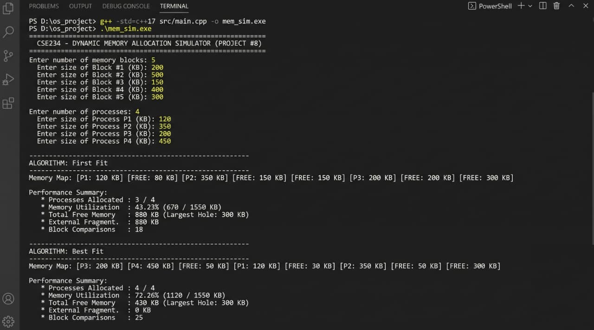
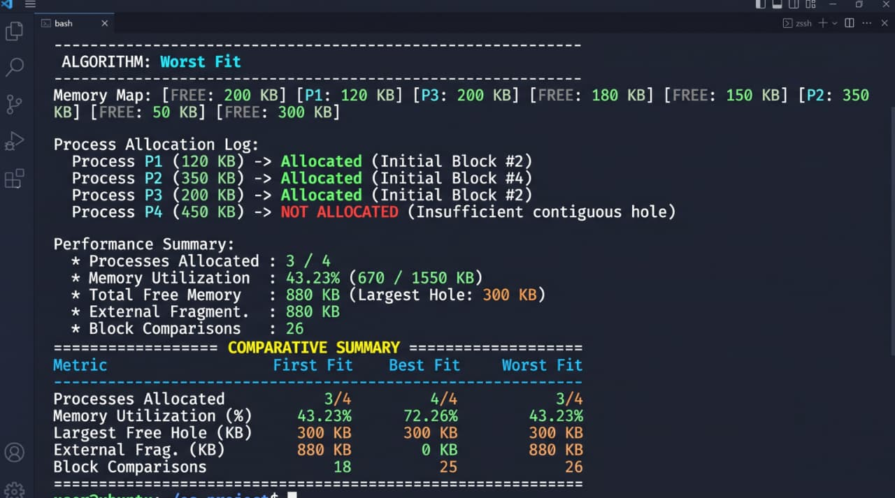
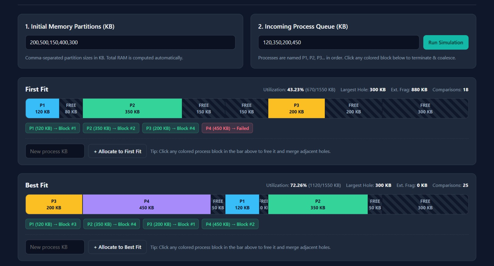
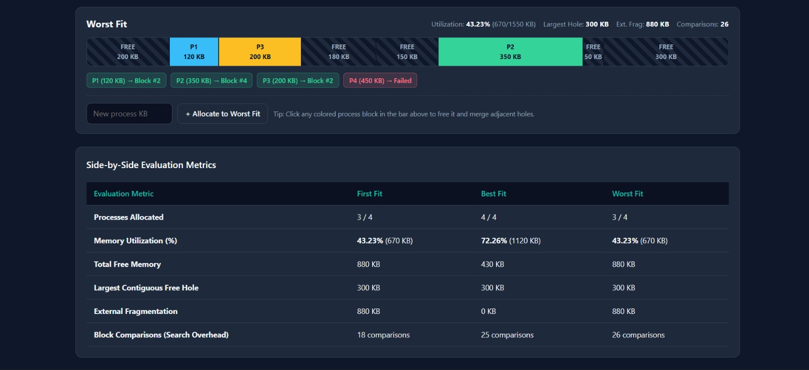

<div align="center">

# 🧠 Dynamic Memory Allocation Simulator
**CSE234: Operating Systems — Project #8 | Lovely Professional University**


*A dual-interface (C++17 CLI + Interactive Browser UI) simulator comparing **First Fit**, **Best Fit**, and **Worst Fit** contiguous memory allocation strategies with dynamic partition splitting and adjacent hole coalescing.*

</div>

---

## 📌 Overview
In multiprogramming operating systems, main memory (RAM) is dynamically partitioned among processes of varying sizes. As processes arrive and terminate over time, free RAM breaks into non-contiguous gaps (**external fragmentation**).

This project implements a fair benchmarking environment that executes **First Fit**, **Best Fit**, and **Worst Fit** on identical initial memory layouts and process queues—measuring **Memory Utilization (%)**, **External Fragmentation (KB)**, **Largest Contiguous Free Hole**, and **Block Search Comparisons**.

---

## ✨ Key Features
* **Three Contiguous Placement Strategies:** Side-by-side execution of **First Fit**, **Best Fit**, and **Worst Fit** on custom user inputs or preset workloads.
* **Dynamic Partition Splitting:** Automatically splits larger free holes into an occupied partition and a leftover free hole when allocating smaller processes.
* **Adjacent Hole Coalescing:** Dynamically merges neighboring free memory blocks upon process termination/deallocation.
* **Dual Interface Architecture:**
  * **C++17 Console Simulator (`src/main.cpp`):** Zero-dependency CLI accepting live user partitions/processes with real-time allocate/deallocate controls.
  * **Interactive Web Companion (`ui/memory_simulator_ui.html`):** Visual RAM bar representation where clicking any allocated process terminates it and merges adjacent holes live.

---

## 🖥️ Execution Screenshots

### 1. C++17 Console Simulator Output
| User Input, First Fit & Best Fit | Worst Fit & Comparative Summary Table |
| :---: | :---: |
|  |  |

### 2. Interactive Web UI Visualizer
| First Fit & Best Fit Partition Bars | Worst Fit & Side-by-Side Metrics |
| :---: | :---: |
|  |  |

---

## 📊 Experimental Benchmark Results
**Test Workload:** Initial Partitions `[200 KB, 500 KB, 150 KB, 400 KB, 300 KB]` *(Total RAM = 1550 KB)*  
**Incoming Processes:** `P1 = 120 KB`, `P2 = 350 KB`, `P3 = 200 KB`, `P4 = 450 KB`

| Evaluation Metric | First Fit | Best Fit | Worst Fit |
| :--- | :---: | :---: | :---: |
| **Processes Allocated** | 3 / 4 (75%) | **4 / 4 (100%)** | 3 / 4 (75%) |
| **Memory Utilization (%)** | 43.23% (670 KB) | **72.26% (1120 KB)** | 43.23% (670 KB) |
| **Total Free Memory** | 880 KB | **430 KB** | 880 KB |
| **Largest Contiguous Free Hole** | 300 KB | 300 KB | 300 KB |
| **External Fragmentation** | 880 KB | **0 KB** | 880 KB |
| **Search Overhead** | **18 comparisons** | 25 comparisons | 26 comparisons |

---

## 🚀 Quick Start

### Option A: Compile & Run the C++17 Simulator
Requires any standard C++ compiler supporting C++17 (`g++`, `clang++`, or MSVC).

```bash
# 1. Clone the repository
git clone [https://github.com/](https://github.com/)<your-username>/cse234-dynamic-memory-simulator.git
cd cse234-dynamic-memory-simulator

# 2. Compile
g++ -std=c++17 src/main.cpp -o mem_sim

# 3. Run (Windows)
mem_sim.exe

# 3. Run (Linux / macOS)
./mem_sim